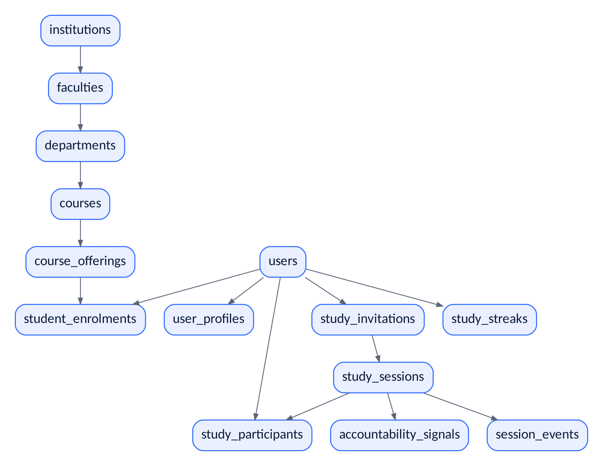
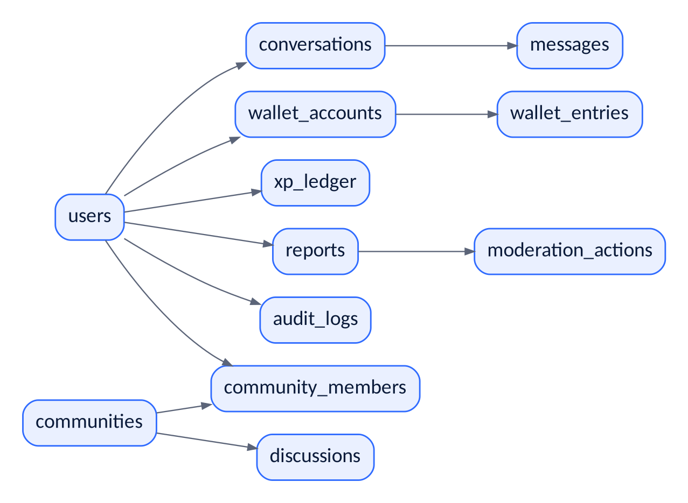

# Database Design and Academic Data Model

> Version v0.1 (Draft for founder review) · 5 November 2026 · Index: [MASTER_BLUEPRINT.md](MASTER_BLUEPRINT.md) · Tracker: [PROJECT_TRACKER.md](PROJECT_TRACKER.md) · Decisions: [DECISION_LOG.md](DECISION_LOG.md)
> Labels: **[CONFIRMED]** fixed by the founder · **[PROPOSED]** recommendation awaiting approval · **[OPEN]** unresolved.

Source chapters in the PDF edition: 08, 17.

## 08. Academic data and curriculum architecture

_Extensible model for institutions, programmes and courses_

### Principles

- **Do not assume uniform structure.** Some institutions have faculties and departments; others use schools, colleges or programmes. Some use sessions and semesters; others use trimesters or modules. **[PROPOSED]**
- **Separate catalogue from enrolment.** A course exists once; a student enrolls in an offering for a session and semester.
- **Separate official from community data.** Every record has a provenance and verification status.
- **Country-agnostic by design.** Country-specific levels and calendars are data, not code.

### Core hierarchy

| Entity | Description | Notes |
|---|---|---|
| country | ISO country, default timezone, language | Drives defaults only |
| institution | University or college; aliases; type; verification config | Unique per country; aliases table for names like LAUTECH |
| campus | Physical location (optional) | Nullable |
| org_unit | Generic tree node: faculty, school, college, department, centre | Self-referencing `parent_id` with a `unit_type`, so structures can vary |
| programme | Degree programme under an org_unit, with degree type | B.Sc., B.Eng., MBBS, etc. |
| level_scheme | Per-institution list of levels (100–500, Year 1–5) | Data, not enum |
| academic_session / term | Calendar periods; flexible term type | Semester, trimester, quarter |
| course | Catalogue entry: code, title, credit units, description | Unique on (institution, code) |
| course_offering | Course in a given term, with level and programme links | Carry-overs handled by enrolment, not duplication |
| syllabus / objective | Official outline and learning objectives | Versioned |
| student_enrolment | User's membership of a programme and offerings | Self-declared until verified |

This design uses a generic organizational unit tree instead of hard-coded faculty and department tables. The ER summary in Chapter 17 uses simplified names for readability; the final schema should adopt the generic tree. **[PROPOSED]**

### Collecting, verifying and maintaining data

| Source | Quality | Process |
|---|---|---|
| Official institution lists and handbooks | High | Admin imports with review; versioned |
| Institution partner (future) | High | API or file feed; contract |
| Student-contributed requests | Low until reviewed | Request queue; two independent confirmations or admin approval |
| Scraped public data | Variable | Only with legal review of terms; not planned for MVP |

- Every record has `source`, `verified_by`, `verified_at` and `status` (official, community, unverified).
- Annual refresh cycle per institution at the start of each session; stale-data alerts.
- Merge tool for duplicate courses and aliases; history preserved.

> **Open decisions**  
> Pilot institution and its structure (OPEN-01). How to source initial course catalogues, since manual entry for even one institution is real effort (OPEN-04). Whether to seek an institutional partnership before launch (OPEN-05).

## 17. Database architecture

_Candidate PostgreSQL schema and concurrency rules_

Candidate schema for PostgreSQL. It is a design baseline, not final SQL. Entities in the brief are covered; names follow the brief with the academic tree generalized as noted in Chapter 08. **[PROPOSED]**

*Figure 10. Entity relationship summary: academic and Study Together domains*

*Figure 11. Entity relationship summary: community, messaging, economy and trust*

### Core entities and constraints

| Entity group | Key tables | Primary / unique / foreign keys |
|---|---|---|
| Identity | users, user_profiles, auth_sessions, roles, user_roles | PK uuid; unique lower(email), unique phone; profile FK users(id) unique; user_roles unique (user_id, role, scope) |
| Academic | institutions, campuses, org_units, programmes, academic_levels, academic_sessions, semesters, courses, course_offerings, student_enrolments | courses unique (institution_id, code); offerings unique (course_id, term_id); enrolments unique (user_id, offering_id) |
| Preferences | study_preferences, study_availability | FK user; availability uses weekday, start, end, timezone |
| Study Together | study_invitations, study_sessions, study_participants, accountability_signals, session_events, study_streaks, reliability_records | participants unique (session_id, user_id); signals FK session and sender, with deadline; session_events append-only with (session_id, seq) unique |
| Community | communities, community_members, discussions, comments | members unique (community_id, user_id); discussions FK community; soft delete |
| Messaging | conversations, conversation_members, messages | messages unique (conversation_id, seq); client message id unique per sender for idempotency |
| Notifications | notifications, notification_preferences | index (user_id, read_at, created_at) |
| Resources and AI | academic_resources, documents, document_chunks, ai_conversations, ai_messages | chunks FK document; vector column with metadata; visibility enum |
| Economy | xp_ledger, wallet_accounts, wallet_transactions, wallet_entries, rewards | entries FK transaction; transaction idempotency_key unique; check constraints |
| Trust | reports, moderation_actions, audit_logs | reports FK reporter and target polymorphic; audit_logs append-only |

### Indexing and query optimization

- Composite indexes matching query shapes, for example (institution_id, course_id, availability_slot) for discovery.
- Partial indexes for active records (status = ACTIVE sessions, unread notifications).
- Full-text indexes for course and community search; trigram for fuzzy names.
- Keyset (cursor) pagination for feeds and messages; avoid deep OFFSET.
- Review slow queries with `EXPLAIN ANALYZE` from the first load test.

### Transactions and concurrency

| Area | Control **[PROPOSED]** |
|---|---|
| Session state changes | Single writer per session; optimistic version column; each transition in one transaction with its event row; unique (session_id, seq) |
| Reward on completion | One transaction: update session, insert XP ledger and streak updates; idempotency key = session id + user id |
| Wallet | Serializable or row-level lock on wallet account; check constraint prevents negative balance; ledger append-only |
| Invitations | Unique pending invitation per (sender, recipient, course); expiry job |
| Messages | Sequence per conversation allocated in-transaction; client id dedupes retries |

### Soft deletion, retention, boundaries and audit

- Soft delete (deleted_at) for user content so moderation and appeals work; scheduled hard delete per retention table (Chapter 11).
- Institution boundary: institution_id on tenant-scoped tables; app-level scoping plus PostgreSQL row-level security as defence in depth.
- Audit: append-only audit_logs; database role used by the app cannot update or delete them.
- Money and ledgers: never updated or deleted; reversals are new rows.
- Partitioning of messages, session_events and notifications by time when volume warrants.

