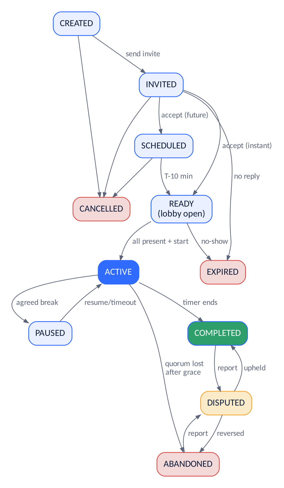
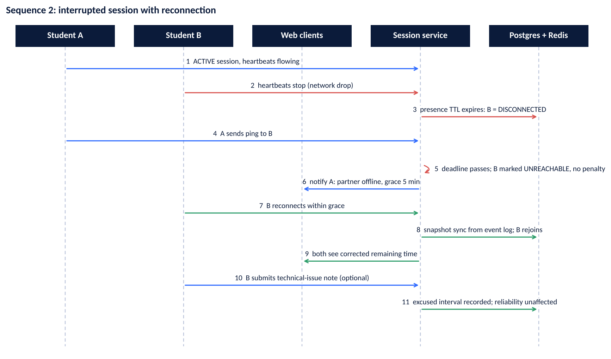
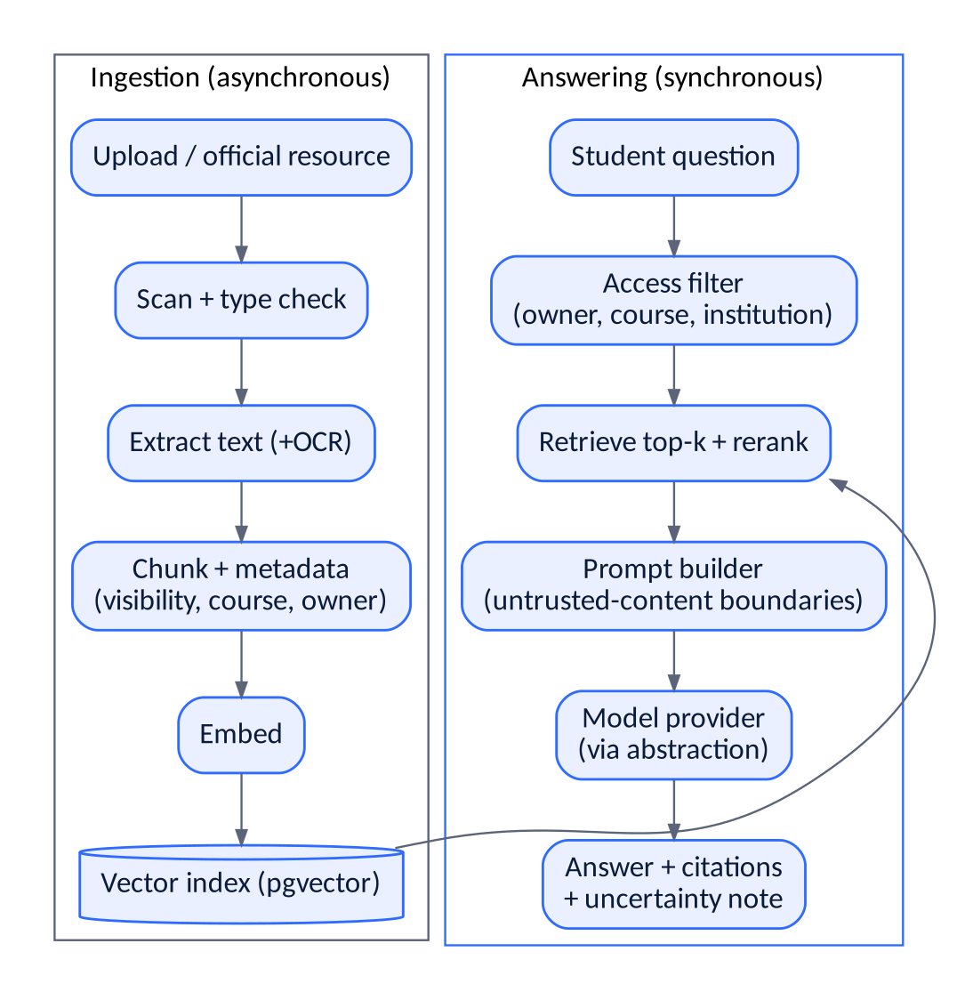

# Feature Specifications (modules, Study Together, AI)

> Version v0.1 (Draft for founder review) · 5 November 2026 · Index: [MASTER_BLUEPRINT.md](MASTER_BLUEPRINT.md) · Tracker: [PROJECT_TRACKER.md](PROJECT_TRACKER.md) · Decisions: [DECISION_LOG.md](DECISION_LOG.md)
> Labels: **[CONFIRMED]** fixed by the founder · **[PROPOSED]** recommendation awaiting approval · **[OPEN]** unresolved.

Source chapters in the PDF edition: 05, 07, 09.

## 05. Complete product module architecture

_22 requested modules plus 6 added by the blueprint team_

Each module below lists purpose, users, key functionality, permissions and business rules, edge cases and risks, dependencies, and release class (MVP, R2, R3, Later). Module numbers follow the brief; modules 23 to 28 are added by the blueprint team to close gaps. **[PROPOSED]**

### Modules 1 to 8: identity, academics, discovery and sessions

| # | Module and purpose | Main functionality and rules | Edge cases and risks | Depends on | Rel. |
|---|---|---|---|---|---|
| 1 | **Authentication and identity**. Prove who the account holder is. | Email or phone signup, verify, login, device sessions, recovery, MFA optional. Rules: one verified identity per account; rate-limited attempts. | Shared phones; SIM swap; lost email; credential stuffing | Notifications | MVP |
| 2 | **Academic onboarding**. Capture academic context. | Country, institution, faculty, department, programme, level, session, semester, courses, interests. Rule: courses from catalogue or request-to-add. | Missing institution; wrong level; carry-over courses | 3, 8 | MVP |
| 3 | **Institution management**. Maintain institution data. | Directory, aliases, structures, verification config. Rule: only admins edit official data. | Duplicate names; renamed institutions; differing structures | 8, 21 | MVP |
| 4 | **Student profiles**. Controlled self-presentation. | Display name, avatar, bio, courses, availability, goals, reliability badge, visibility settings. Rule: private by default beyond institution. | Doxxing; impersonation; real-name disclosure | 1, 2 | MVP |
| 5 | **Student discovery**. Find relevant students. | Filters: course, level, department, availability, goal, language, timezone. Rule: only verified, opted-in users appear. | Harassment by repeated search; scraping | 4, 6, 20 | MVP |
| 6 | **Study partner matching**. Rank and propose partners. | Transparent scoring (course overlap, schedule overlap, reliability, goals). Invite, accept, decline, mute, block. Rule: invitation rate limits. | Spam invitations; popularity bias; cold start | 5, 7 | MVP |
| 7 | **Study Together**. Commit and study together. | Chapter 07. Sessions, timers, pings, streaks, reliability. | Disconnection, disputes, gaming | 1, 6, 15 | MVP |
| 8 | **Study rooms**. Persistent small rooms for repeat partners or groups. | Private rooms with member list, shared goals, scheduled sessions. Rule: membership invite-only. | Room hijack; abandoned rooms | 7, 11 | R2 |

### Modules 9 to 15: community, messaging, AI and notifications

| # | Module and purpose | Main functionality and rules | Edge cases and risks | Depends on | Rel. |
|---|---|---|---|---|---|
| 9 | **Academic communities**. Institution and course spaces. | Auto-join by verified course; announcements; roles. Rule: scoped to institution; moderators appointed. | Off-topic drift; moderator abuse | 2, 20 | MVP basic |
| 10 | **Discussion and Q&A**. Useful academic contribution. | Questions, answers, accept answer, tags, upvotes. Rule: rate limits, quality signals over raw likes. | Cheating requests; misinformation | 9, 20 | MVP basic |
| 11 | **Messaging**. Direct and group chat. | 1:1 and group chat, delivery states, attachments, mute, block. Rule: DMs only between users who share a course or accepted invite. | Harassment; spam; content in private chats | 1, 20 | MVP basic |
| 12 | **Voice and video**. Co-presence in sessions. | Opt-in audio/video inside accepted sessions; camera off by default; no recording by default. | Bandwidth; exposure; abuse | 7, 11, 20 | R3 |
| 13 | **AI study assistant**. Course-aware help. | Chat, summarize, flashcards, quizzes, with citations. Rule: private materials never cross users. | Hallucination; cost; prompt injection; privacy | 14 | R2 |
| 14 | **Academic resource management**. Store and verify resources. | Upload, scan, tag, version, official vs community label, takedown. | Copyright; malware; low quality | 3, 20 | R2 |
| 15 | **Notifications**. Timely, respectful nudges. | In-app, email, web push; preferences; quiet hours. Rule: no dark patterns. | Alert fatigue; delivery failure; cost | 1 | MVP |

### Modules 16 to 28: economy, safety, operations

| # | Module and purpose | Main functionality and rules | Edge cases and risks | Depends on | Rel. |
|---|---|---|---|---|---|
| 16 | **XP and achievements**. Recognize effort. | Append-only XP ledger; levels; badges. Rule: XP is non-spendable. | Farming; inflation | 7 | MVP basic |
| 17 | **Virtual wallet**. Hold coins. | Double-entry ledger, balances derived. Rule: no cash-out; no transfer by default. | Fraud; chargebacks; regulation | 18, 19 | R3 |
| 18 | **Rewards**. Redeemable perks. | Catalogue, limits, entitlements. | Abuse; unfair access | 16, 17 | R3 |
| 19 | **Advertising and monetization**. Revenue. | Subscriptions first; sponsored academic content; rewarded ads later. | Trust loss; ad fraud; child safety | 17 | R3 |
| 20 | **Moderation and reporting**. Safety. | Report flows, queue, actions, appeals, evidence retention. | Moderator load; false reports | All social modules | MVP |
| 21 | **Administration dashboard**. Operate the platform. | User, institution, verification, reports, flags, audit view. | Privilege abuse | 20, 22 | MVP basic |
| 22 | **Analytics and insights**. Measure and learn. | Event tracking, product metrics, privacy-preserving aggregates. | Over-collection; vanity metrics | All | MVP basic |
| 23 | **Consent and privacy centre** (added). User data rights. | Consent records, export, deletion, visibility controls. | Deletion vs retention conflicts | 1 | MVP |
| 24 | **Support and help** (added). Resolve issues. | Help centre, ticketing, session-dispute intake. | Support load | 21 | MVP basic |
| 25 | **Feature flags and experiments** (added). Safe rollout. | Flags, staged rollout, kill switches. | Flag debt | 21 | MVP |
| 26 | **Search** (added). Find courses, people, posts. | Postgres full-text first; dedicated engine later. | Relevance; privacy leakage | 9,10 | R2 |
| 27 | **Onboarding and education content** (added). Teach the product. | Guided first session, tooltips, fair-play rules. | Drop-off | 1,2 | MVP |
| 28 | **Calendar and reminders** (added). Scheduled sessions. | Session schedule, reminders, ICS export. | Time zones, DST-free Nigeria but other countries differ | 7,15 | MVP basic |

Missing capabilities flagged for founder attention: offline-tolerant behaviour, low-data mode, accessibility, data-subject request handling, and a trust and safety operations process. These are cross-cutting and appear in later chapters. **[PROPOSED]**

## 07. Study Together: functional specification

_State machine, timers, pings, fairness, streaks, disputes_

Study Together is the signature feature **[CONFIRMED]** and is specified as a standalone system. All numbers below are PROPOSED defaults, to be tuned by pilot data. **[PROPOSED]**

### Design goals

- Make commitment real: a shared, authoritative timer and a visible partner.
- Make accountability **fair**: distinguish inactivity from inability to respond.
- Avoid invasive surveillance: no screen capture, no keystroke or app tracking, no mandatory camera.
- Be resilient: sessions survive refreshes, brief drops and device switches.
- Be hard to game: rewards depend on server-verified events.

### Session lifecycle and state machine

*Figure 3. Study session state machine*

| State | Meaning | Allowed next states | Who can trigger |
|---|---|---|---|
| CREATED | Host drafted session | INVITED, CANCELLED | Host |
| INVITED | Invites sent | SCHEDULED, READY, EXPIRED, CANCELLED | Invitee accepts; host cancels; system expires |
| SCHEDULED | Future start agreed | READY, CANCELLED | System at T-10 min; host or all-but-one |
| READY | Lobby open | ACTIVE, EXPIRED | Participants ready (quorum); system on no-show |
| ACTIVE | Timer running | PAUSED, COMPLETED, ABANDONED | Participants (pause); system (end, abandon) |
| PAUSED | Agreed break | ACTIVE, ABANDONED | Any participant resumes; system on break timeout |
| COMPLETED | Finished normally | DISPUTED | System; dispute by participant within 48h |
| ABANDONED | Quorum lost beyond grace or all left | DISPUTED | System |
| EXPIRED / CANCELLED | Never started | terminal | System / host |
| DISPUTED | Under review | COMPLETED, ABANDONED | Moderator or automated rule |

Invalid transitions are rejected by the server and logged. Every transition writes an append-only `session_events` row and is performed by a single writer per session to avoid races. **[PROPOSED]**

### Configuration at creation

| Setting | Options | Default **[PROPOSED]** |
|---|---|---|
| Participants | 2 (MVP); up to 5 (R2 small group) | 2 |
| Duration | 15 minutes to 4 hours (example in brief: four hours) | 60 minutes |
| Cycle | Continuous or focus and break blocks | 50 / 10 |
| Ping policy | Off, light (1 per 25 min), custom | Light |
| Response window | 30 to 180 seconds | 90 seconds |
| Camera/audio | Off in MVP | Off |
| Goal text | Each participant states a goal | Required, short |

### Shared timer and realtime synchronization

- **Server-authoritative time.** The server stores `startedAt` and `endsAt`. Clients render countdowns from a server-time offset measured at connect, so client clocks do not matter.
- **Snapshot plus events.** On connect or reconnect the client fetches a full snapshot, then applies events from the last sequence number. Idempotent event ids prevent double processing.
- **Transport.** WebSocket (Socket.IO) with automatic reconnection and long-polling fallback, appropriate for unstable networks. **[PROPOSED]**
- **WebRTC is not needed** for timers or pings; it is introduced only for audio/video in Release 3.

### Presence and heartbeats

Each client sends a heartbeat every 15 seconds while the tab is visible and every 30 seconds in the background. Redis keys with a time-to-live of 45 seconds represent presence. Presence has three values: **PRESENT**, **AWAY_UNREACHABLE** (heartbeat lost) and **OFFLINE_EXCUSED** (within grace after a verified disconnection). Heartbeats prove a connected client, not attention, and the product says so honestly. **[PROPOSED]**

### Accountability signals (pings)

1. Sender sends ping. The server creates a signal with a deadline = now + response window.
2. Recipient sees an in-app prompt and, if the tab is hidden, a web-push or title flash.
3. One tap acknowledges. A trivial action is deliberate: the goal is presence, not a quiz.
4. If acknowledged by the deadline: *responded*. Else: the server checks presence. If heartbeats were lost for part of the window the result is *unreachable (excused)*. If heartbeats were healthy but no ack: *missed*.
5. Only *missed* counts against commitment, and a single miss never ends a session.

> **Why this is fair**  
> The system never punishes a missed ping when the client was disconnected, in a different app on a mobile browser, or covered by an agreed break. It only counts a miss when the connection was demonstrably healthy and the student did not respond. Repeated misses are shown to the partner as a gentle flag first, not an automatic penalty.

### Pause, breaks and grace periods

- **Agreed break.** Any participant can request; others acknowledge; breaks have a maximum length (default 10 min).
- **Reconnection grace.** 5 minutes after heartbeat loss before a participant is considered away; 10 minutes before the session can be marked ABANDONED for lack of quorum.
- **Emergency exit.** A one-tap “I have to go” records a consented leave without penalty, with limited use per week to deter abuse.
- **Excused interval.** Participants can attach a short technical-issue note; patterns are monitored.

*Figure 4. Sequence diagram: interrupted session with reconnection*

### Completion criteria

| Criterion | Rule **[PROPOSED]** |
|---|---|
| Completed | Timer reaches end and each participant was present for at least 80% of active time (excused intervals excluded from the denominator). |
| Partial | Participant present at least 50% but left by consent: partial XP, streak unaffected. |
| Abandoned | Fewer than quorum present beyond grace: no completion rewards for anyone. No penalty to the participant who stayed. |
| Group | At least two participants present for the session to count; each participant judged on own presence. |

### Streaks, reliability, rewards and penalties

- **Streak.** Consecutive days with at least one completed session of 25 minutes or more. One “freeze” per 14 days. Based on the user's configured timezone.
- **Reliability.** A rolling 30-session score derived from: attended / scheduled, completed / started, and missed pings with healthy heartbeat. Shown to partners as bands (Building, Steady, Reliable), not a raw number, to reduce shaming. Excused events are excluded.
- **Rewards.** XP on completion scaled by duration up to a daily cap. No coins in MVP.
- **Penalties are mild.** No negative XP. Consequences: temporary pause in session invitations after repeated no-shows, and reliability band changes. No financial penalties.

### Disputes and fraud prevention

| Scenario | Handling |
|---|---|
| Partner says “you left” but heartbeat shows present | Event log is the evidence. Auto-resolve in favour of the log. |
| Both claim the other disconnected | Compare log; if inconclusive, no penalty to either; reward reduced. |
| Collusion: two accounts start long sessions and idle for XP | Presence quality checks (interaction diversity), daily caps, rate limits per pair, anomaly flags for review. |
| Multi-account farming | Verified academic identity, device and rate signals, manual review for outliers. |
| Client tampering (fake heartbeat) | Server-side authority; heartbeats must carry a signed session token; this cannot prove attention, so rewards stay modest. |
| Harassment during session | Report, remove participant, end session without penalty to the reporter. |

> **Known limitation**  
> Without camera or screen monitoring, no system can prove a student is truly studying. Cahootz accepts this: the mechanic builds social commitment, not proof of work. Camera-on is optional, consent-based and not required for rewards.

### Group sessions (Release 2)

- 2 to 5 members; creator can remove members; quorum is two.
- Pings can target one member or “all”; response windows apply individually.
- Group goal plus individual goals; summary lists attendance (excused shown neutrally).

Technical feasibility: the realtime load per session is tiny (heartbeats and rare events). A single Node instance can hold thousands of such connections. The hard parts are correct state transitions and reconnection, not throughput. **[PROPOSED]**

## 09. AI and learning intelligence

_RAG, privacy, cost and evaluation_

AI is an integrated tool, not the identity of Cahootz **[CONFIRMED]**. It is a Release 2 feature **[PROPOSED]**, so this chapter defines the target design and the controls needed before launch.

*Figure 5. Retrieval-augmented generation pipeline with access filtering*

### Architecture components

| Component | Design **[PROPOSED]** | Why |
|---|---|---|
| Model abstraction | Internal `LlmProvider` interface (chat, embed, moderate) with adapters per provider; routing by task and cost tier | Avoid lock-in; allow fallback and price changes |
| Document ingestion | Upload, malware scan, MIME check, text extraction, OCR only when no text layer, language detection | Many Nigerian notes are scans or photos |
| Chunking | Structure-aware chunks (headings, slides) of a few hundred tokens with overlap; metadata: owner, visibility, course, source, version | Retrieval quality and access control |
| Embeddings and vector store | Postgres with pgvector initially, filtered by metadata; dedicated vector DB only when scale or latency requires | One database to operate in early stage |
| Retrieval | Hybrid: keyword plus vector, top-k, rerank, mandatory access filter before ranking | Precision and privacy |
| Citations | Every answer cites chunk ids shown as document, page or slide; “no source found” is a valid answer | Hallucination mitigation and trust |
| Conversation memory | Short rolling window plus optional saved facts the student approves; per-course threads | Control tokens and privacy |
| Cost control | Per-user quotas, caching of embeddings and common answers, small model for simple tasks, max token caps, batch processing for flashcards | AI is a major cost driver |
| Rate limiting | Per user and per IP; separate limits for uploads | Abuse and cost |

### Using the right institution and course context without leakage

- Every chunk carries a **visibility** label: PRIVATE (owner only), COURSE_COMMUNITY (verified members of that course), INSTITUTION_OFFICIAL, PUBLIC.
- Retrieval applies the filter *before* similarity ranking, using the authenticated user's verified enrolments. Failing closed: no filter means no results.
- Private uploads never enter shared indexes and are never used to train models. Provider contracts must state no training on customer data. **[OPEN]**
- Cross-tenant leak tests are release blockers (Chapter 20).

### Institution resources: indexing, verification, updates

Official resources (syllabi, past questions provided with permission) are ingested by admins, labelled OFFICIAL with version and effective session, and re-indexed when replaced. Community resources are labelled COMMUNITY and ranked below official ones. Copyright and licensing for past questions and lecture notes is unresolved and needs legal review. **[OPEN]**

### Safety, quality and evaluation

- **Prompt injection.** Uploaded documents are untrusted data. Prompts separate instructions from retrieved content, strip or neutralize embedded instructions, and the model has no tools that can act on the account. See OWASP LLM Top 10.
- **Hallucination.** Answer only from retrieved sources for course-specific questions; show confidence and sources; allow “report wrong answer”.
- **Academic integrity.** The assistant explains and tutors; it declines to write graded submissions on request. **[PROPOSED]**
- **Evaluation.** A fixed test set per pilot course (questions with expected citations) run on every prompt or model change; track groundedness, citation accuracy, refusal quality and cost per answer.
- **Privacy.** Clear notice of what is sent to providers; data minimization (strip identifiers); retention limits for AI conversations; user deletion.

### Free versus paid **[PROPOSED]**

| Capability | Free | Paid |
|---|---|---|
| Ask course-aware questions with citations | Daily quota | Higher quota |
| Flashcards and quiz generation | Limited monthly | Higher limits |
| Document upload and analysis | Small size and count | Larger and more files |
| Revision schedule | Basic | Personalized |
| Priority and faster models | No | Yes |

Principle: essential academic access, such as official syllabus and community Q&A, never requires payment **[CONFIRMED]**. Only usage-heavy AI conveniences are candidates for payment. **[PROPOSED]**

