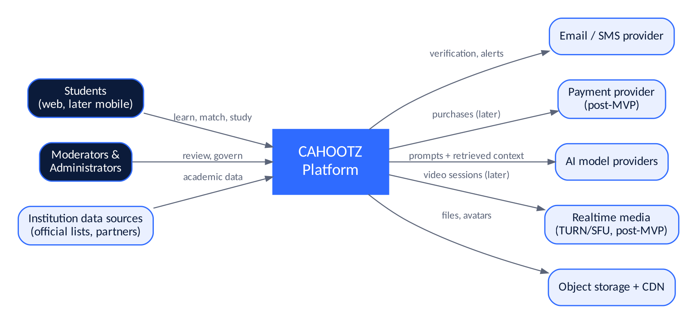
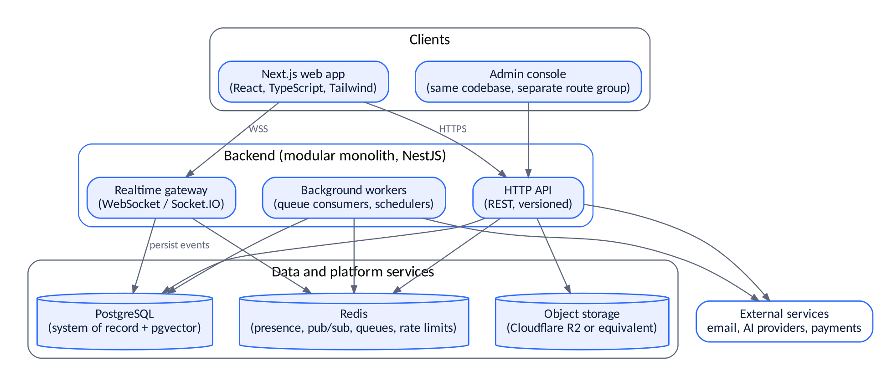
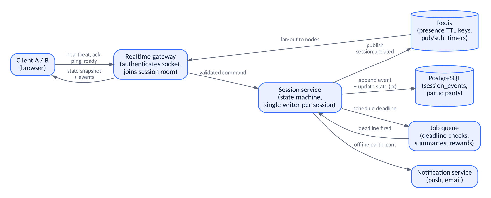
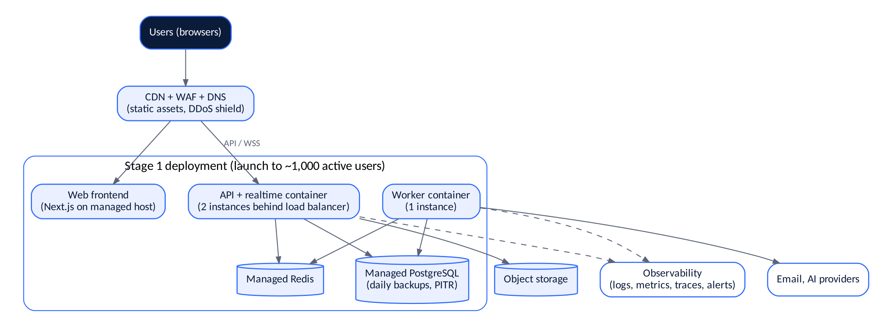

# System Architecture (communication, architecture, operations)

> Version v0.1 (Draft for founder review) · 5 November 2026 · Index: [MASTER_BLUEPRINT.md](MASTER_BLUEPRINT.md) · Tracker: [PROJECT_TRACKER.md](PROJECT_TRACKER.md) · Decisions: [DECISION_LOG.md](DECISION_LOG.md)
> Labels: **[CONFIRMED]** fixed by the founder · **[PROPOSED]** recommendation awaiting approval · **[OPEN]** unresolved.

Source chapters in the PDF edition: 10, 16, 21.

## 10. Social and communication architecture

_Messaging, presence, notifications and media_

### Technology introduction plan

| Technology | Why needed | When **[PROPOSED]** | Trade-off |
|---|---|---|---|
| HTTPS REST | Most operations are request/response | MVP | Simple and cacheable; not push |
| WebSocket via Socket.IO | Session state, presence, chat delivery, typing | MVP | Needs sticky sessions or adapter at scale; reconnection built in |
| Redis pub/sub and TTL keys | Fan-out across nodes; presence expiry | MVP | Another component to run; not durable |
| Web push and email | Reach offline users | MVP | Push support varies by browser and OS |
| Message persistence in PostgreSQL | Durable chat history | MVP | Table growth; plan partitioning later |
| Object storage + CDN | Attachments and avatars | MVP | Scanning needed |
| WebRTC with TURN/STUN | Audio/video study | Release 3 | Bandwidth cost; TURN relay costs money; complexity |
| SFU media server | Group video efficiently | Later, only if group video grows | Significant operations burden; consider managed provider |

### Messaging design

- **Delivery states:** sent (server stored), delivered (client received), read (opt-in). Clients retry with idempotency keys; messages are ordered by server sequence per conversation.
- **Persistence first.** A message is stored before it is broadcast. Broadcast failure never loses a message.
- **Presence and typing indicators** are ephemeral (Redis, TTL) and can be disabled by the user. Read receipts are optional.
- **Group permissions:** owner, admin, member; admins add or remove members; members cannot add strangers.
- **Who can message whom:** students who share a verified course, have an accepted invitation, or share a group. Blocking is symmetric. **[PROPOSED]**
- **Attachments:** allow-listed types, size caps, malware scan, signed URLs, no executable files.
- **Rate limits:** per-user and per-conversation message rate; new-account limits stricter.

### Notification delivery

A notification service receives domain events and applies user preferences, quiet hours and per-channel rules. Channels: in-app (always), web push, email, and SMS only for security events because of cost. Deduplicate and batch low-priority events. Failures retry with backoff and are visible in operations dashboards. **[PROPOSED]**

### Voice and video design (Release 3)

- Only inside accepted sessions or authorized groups. No random matching **[CONFIRMED]**.
- Camera and microphone off by default; explicit browser permission; per-session consent.
- WebRTC peer-to-peer for two participants, with TURN relay fallback. Use a managed provider for TURN and SFU initially rather than self-hosting. **[PROPOSED]**
- No recording by default **[CONFIRMED]**; any future recording requires explicit consent of all participants and a retention policy.
- Adaptive audio-first mode: audio-only or low-resolution video when bandwidth is poor.

### Designing for unstable connectivity

- Light payloads, compressed assets, skeleton loading states and an optional low-data mode.
- Offline-tolerant queueing for non-critical actions; clear banners when disconnected.
- Session logic never trusts a single missed heartbeat (Chapter 07).
- Test on throttled 3G profiles and mid-range Android browsers as a baseline.

## 16. Technical system architecture

_Modular monolith, stack evaluation, domains and diagrams_

### Modular monolith versus microservices

Recommendation: **a modular monolith**, matching the founder's preference to avoid premature microservices. **[CONFIRMED]** One deployable backend with strict internal module boundaries, separate database schemas per domain where useful, and in-process events, extracted into services only when a signal demands it.

| Factor | Modular monolith | Microservices |
|---|---|---|
| Team size | Fits 1 to 8 engineers | Needs platform expertise |
| Operations | One service to deploy and monitor | Many services, tracing, service discovery |
| Transactions | Simple ACID across modules | Distributed consistency problems |
| Speed of change | Fast early on | Slower coordination |
| Scaling | Scale whole app or split hot spots | Independent scaling |
| Risk | Boundary erosion without discipline | Premature complexity |

Mitigation for boundary erosion: modules expose only service interfaces; no cross-module database access; lint rules enforce imports; domain events for cross-module reactions. Candidates for early extraction if signals appear: realtime gateway, media, AI workers. **[PROPOSED]**

### Technology evaluation **[PROPOSED]**

| Layer | Initial direction (from brief) | Assessment |
|---|---|---|
| Frontend | Next.js, React, TypeScript, Tailwind | Strong ecosystem and hiring pool; server rendering helps first load on slow networks. Keep client bundles small. |
| Backend | Node.js with NestJS | NestJS gives modules, dependency injection and structure suited to a modular monolith. Alternatives (Fastify with a custom structure) are lighter but need more discipline. |
| Database | PostgreSQL | Right default: relational integrity, transactions, JSON, full-text, pgvector. |
| ORM | Prisma or Drizzle | Prisma: mature, productive, migration tooling. Drizzle: SQL-close, lighter, good for complex queries. Recommend deciding by a small spike (OPEN-08). |
| Realtime | WebSockets / Socket.IO | Socket.IO adds reconnection and fallbacks, useful on poor networks. Redis adapter for scale. |
| Cache and presence | Redis | Presence TTL, pub/sub, rate limits, queues (BullMQ). |
| Storage | Cloudflare R2 or equivalent | S3-compatible, low egress cost; verify regional performance for Nigeria. |
| AI | Provider abstraction, retrieval, vector search | Start with pgvector. Revisit at scale. |
| Deployment | Scalable cloud | Start managed (containers, managed Postgres and Redis). Region choice affects latency for Nigerian users; evaluate Europe or Africa regions (OPEN-09). |

### Domain boundaries

| Domain | Owns | Does not own |
|---|---|---|
| Identity | Accounts, credentials, sessions, MFA, roles | Academic data |
| Institutions | Institutions, org units, programmes, courses, verification config | Student activity |
| Students | Profiles, preferences, availability, enrolments | Sessions |
| Discovery | Search, match scoring, invitations | Session execution |
| Study sessions | State machine, timers, signals, streaks, reliability | Chat |
| Academic communities | Communities, posts, Q&A, resources metadata | Moderation decisions |
| Messaging | Conversations, messages, receipts | Notifications delivery |
| AI | Ingestion, retrieval, assistant, quotas | Raw file storage |
| Wallet | Ledgers, rewards, purchases | Gamification rules |
| Moderation | Reports, actions, appeals, evidence | Content storage |
| Notifications | Preferences, templates, delivery | Event creation |
| Administration | Staff UI, feature flags, audit viewing | Business rules |

### System context and container architecture

*Figure 6. System context diagram*

*Figure 7. Container architecture diagram*

### Component and data flow

Inside the backend each domain is a Nest module with a controller layer (HTTP and WebSocket gateways), application services, domain logic and repositories. Requests flow: client, API gateway layer (auth, rate limit), controller, service, repository, PostgreSQL; side effects publish domain events consumed by workers (notifications, XP, analytics). Realtime commands flow through the gateway to the Study sessions service, the single writer of session state.

*Figure 8. Realtime event architecture for Study Together*

### Deployment architecture

*Figure 9. Initial deployment architecture*

All environments (development, staging, production) use infrastructure as code. Staging mirrors production on a smaller scale. Secrets live in a managed secrets store. Continuous integration runs tests and scans on every pull request; deployments are automated with rollback. **[PROPOSED]**

## 21. Administration and operations

_Internal tools, roles and permissions_

| Area | Capabilities | Roles **[PROPOSED]** |
|---|---|---|
| User management | Search, view status, restrict, force logout, export or delete requests | Support (limited), Platform admin |
| Institution and academic data | Create and merge institutions, org units, courses; import | Platform admin, Institution admin (own) |
| Verification queue | Review documents with masked data; approve or reject with reason; auto-delete documents | Verification reviewer |
| Community moderation | Queue, bulk actions, community rules | Moderators |
| Reports and appeals | Triage, evidence, sanctions ladder | Moderator, Senior moderator |
| Content management | Official resources, announcements, help content | Content admin |
| Wallet and rewards oversight | View ledger, freeze wallets, issue compensating entries by dual approval | Finance admin (R3) |
| Advertising management | Campaign review and labelling | Ads admin (later) |
| Analytics | Aggregated dashboards; no raw private content | Analyst, Platform admin |
| Audit trails | Searchable audit log; export | Super admin, Compliance |
| System health | Dashboards for errors, queues, sockets, costs | Engineers |
| Feature flags | Create, target and roll out flags; kill switches | Platform admin, Engineers |
| Support operations | Ticket handling, session-dispute intake, macros | Support |

Principles: least privilege; separate staff accounts with mandatory MFA; sensitive actions require a reason; dual approval for money-related corrections; staff access to user data is logged and reviewed monthly; no direct production database access for non-engineers. **[PROPOSED]**

