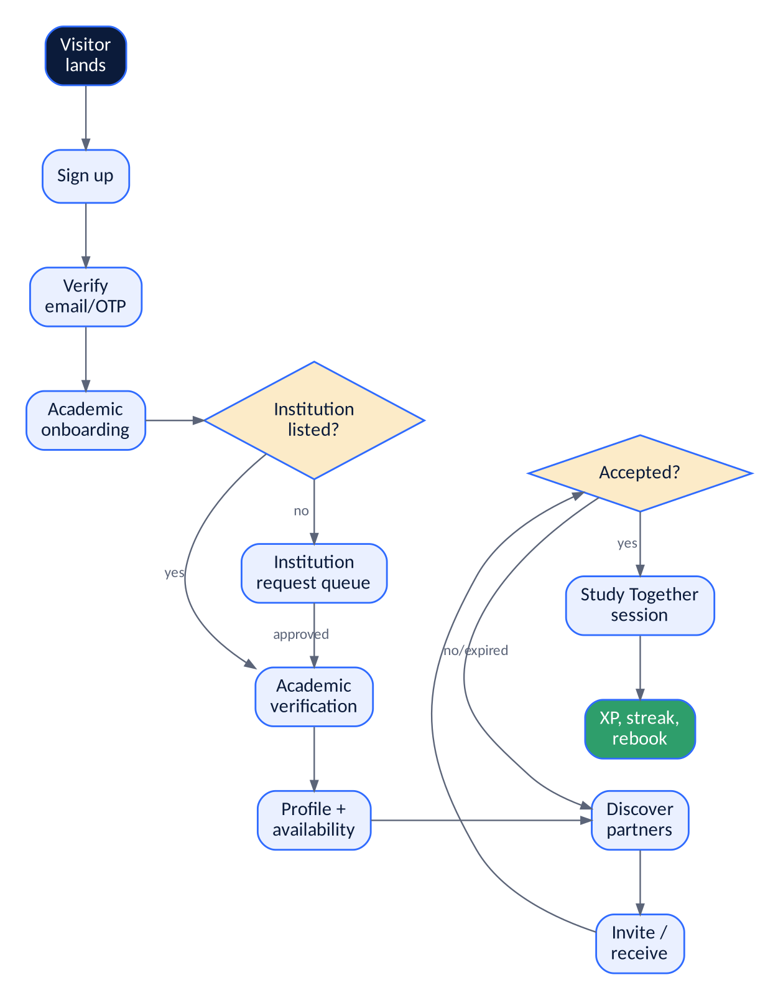
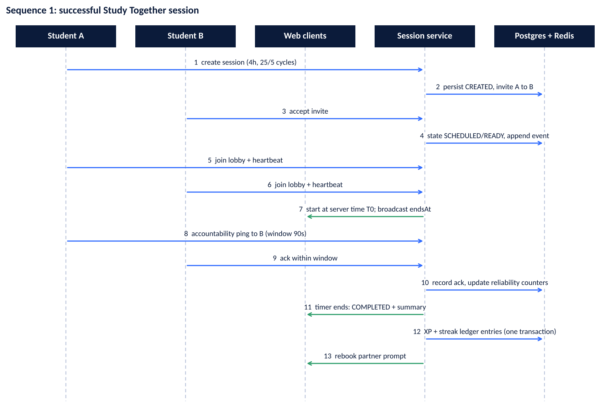

# User Journeys

> Version v0.1 (Draft for founder review) · 5 November 2026 · Index: [MASTER_BLUEPRINT.md](MASTER_BLUEPRINT.md) · Tracker: [PROJECT_TRACKER.md](PROJECT_TRACKER.md) · Decisions: [DECISION_LOG.md](DECISION_LOG.md)
> Labels: **[CONFIRMED]** fixed by the founder · **[PROPOSED]** recommendation awaiting approval · **[OPEN]** unresolved.

Source chapters in the PDF edition: 06.

## 06. Detailed user journeys

_End-to-end flows with alternatives and failures_

*Figure 1. Core journey from visitor to completed first session*

The diagram shows the happy path. Alternative paths and failure conditions follow for each journey. **[PROPOSED]**

| Journey | Steps (happy path) | Alternatives and failures |
|---|---|---|
| First-time visitor | Land, see value, view sample partner cards (no personal data), sign up. | Slow network: lightweight page; unsupported browser notice. |
| Registration | Email or phone, password or passkey, verify code, accept terms and privacy notice. | Wrong code, expired code, duplicate account, disposable email blocked, rate limit hit. |
| Student onboarding | Choose country, institution, department, programme, level, session, courses, interests. | Institution missing: request queue. Course missing: request. Under-18 declared: restricted path (Chapter 12). |
| Academic verification | Choose method, submit code or document, wait for status, receive result. | Rejected: reason and retry; manual review queue; document deleted after decision per retention rule. |
| Complete profile | Display name, avatar, bio, availability, goals, privacy choices. | Inappropriate avatar: automated and manual review. |
| Find a study partner | Open Discover, filter by course and time, view cards, send invite with message. | No matches: widen filters, join community, set “looking now” signal. |
| Send/accept invitations | Send, partner notified, accept or decline, session created. | Expired, withdrawn, blocked sender, invitation limit reached. |
| Start a session | Both open lobby, ready check, server starts timer. | Partner no-show: wait window, then EXPIRED with no penalty to the present student. |
| Respond to accountability signal | Receive ping, tap acknowledge within window. | Offline: grace and excused interval (Chapter 07). |
| Complete a session | Timer ends, summary, reflect on goal, XP and streak awarded, rebook prompt. | Early finish by consent; partial credit rules. |
| Handle failed session | State ABANDONED or EXPIRED, reason shown, dispute option. | Dispute reviewed within SLA; outcome may restore streak. |
| Join communities | Auto-suggested by verified courses, join, read rules. | Private or full communities; moderator approval. |
| Ask questions | Post with course tag, similar-question suggestions, receive answers, accept one. | Rule violation: hold for review; academic misconduct flag. |
| Upload study materials | Select file, declare ownership and type, scan, publish as community material. | Malware, copyright claim, duplicate; takedown path. |
| Use AI assistant (R2) | Pick course, ask or upload, receive cited answer, save flashcards. | Quota reached; no source found; unsafe request. |
| Earn and spend coins (R3) | Complete sessions, earn XP always; coins via capped rules; spend on cosmetics. | Reversal after dispute; fraud hold; refund. |
| Report content | Tap report, pick reason, add note, submit, receive receipt. | Duplicate report; abusive reporting; urgent safety escalation. |
| Block another user | Block from profile or chat; mutual invisibility; sessions cancelled. | Shared community: content still visible but interactions blocked. |
| Recover an account | Request reset, verify, set new credential, review active sessions. | Lost email: manual recovery with strict proof; cooling-off period. |

### Sequence: first successful session

*Figure 2. Sequence diagram: successful Study Together session*

See Chapter 07 for the interrupted-session sequence and the state machine.

